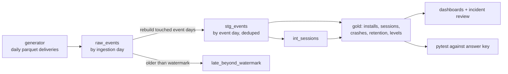

# Game telemetry on ClickHouse: did build 3.5.0 hurt retention?

[](https://github.com/Saigwe/game-telemetry-clickhouse/actions/workflows/ci.yml)
[](https://saigwe.github.io/game-telemetry-clickhouse/)

**Live dashboards: [saigwe.github.io/game-telemetry-clickhouse](https://saigwe.github.io/game-telemetry-clickhouse/)**

A mobile game ships build 3.5.0 and day-1 retention on the dashboard drops. This repo answers whether players really
left, or whether the measurement changed, using a ClickHouse event pipeline built to survive what real SDK telemetry
does: duplicate deliveries from retries, events days late from offline play, a dropped build ID, clocks running
backwards, a schema change mid-season and a new event name nobody registered.

Built end to end: a seeded event generator (GA4-style export shape), a ClickHouse schema partitioned by ingestion and
event day, an incremental day-by-day pipeline with a three-day watermark and an idempotency check, a full backfill,
gold reporting tables, a benchmark, 26 tests that run against a real ClickHouse server in CI, six web dashboards and a
generated incident review.

**Everything here is invented.** The game, its players and every event come from `generator/simulate.py` (seed 41).
Players are random pseudo-IDs. The results are demo results, not any studio's figures.

## The answer

From the current CI build ([analysis/incident_review.py](analysis/incident_review.py) writes the full review):

| Platform | Build | Installs | D1 on `session_start` | D1 on any engagement |
|---|---|---|---|---|
| Android | 3.4.1 | 2,517 | 54.7% | 54.7% |
| Android | 3.5.0 | 3,365 | 51.4% | 51.4% |
| iOS | 3.4.1 | 1,648 | 55.0% | 55.0% |
| iOS | 3.5.0 | 2,270 | **28.7%** | **52.9%** |

- **iOS is a logging change, not a player change.** From 3.5.0, iOS sends a new event, `app_resume`, where it used to
  send `session_start`. Retention defined on `session_start` halves; defined on any engagement it is flat.
- **Android is a real regression.** On low-memory Android devices, 3.5.0 crashes at the start of level 7: 1,046 crashes
  in 2,494 level-7 starts (41.9%), against 0.2% to 0.4% everywhere else. Crash-free sessions on Android fell from 98.7%
  to 94.7%, and players who crash on day 0 come back less, so Android D1 fell from 54.7% to 51.4%.

The planted truth is in `data/raw/answer_key.json`; the tests assert the pipeline recovers it.

## What the pipeline deals with

| Problem in the feed | Volume | Handling |
|---|---|---|
| Duplicate deliveries (SDK retries, one retry storm on 12 Oct) | 28,376 | dedupe on `event_id` in staging |
| Events with no build ID | 3,992 | filled from the session's first event |
| Deliveries more than 3 days late (offline play) | 19,026 | counted past the watermark, picked up by the backfill |
| Out-of-order timestamps (clock skew) | 1,277 | flagged by client sequence, not dropped |
| Schema v1 `level` vs v2 `level_id` | all level events | mapped to one column; a test fails on any unmapped event |
| New event name `app_resume` | 1 | surfaced by the instrumentation check |
| Crash reports sent on the next app open | 298 (109 outside 72h) | attributed to the session they happened in |



## Incremental, idempotent, and checked against a full rebuild

The daily run loads one ingestion day, then rebuilds only the event-day partitions that day touched, within a
three-day watermark. Rebuilding a partition means drop and re-insert from every delivery received so far, so a rerun
gives the same result. CI proves both:

- Incremental over 67 ingestion days: **1,136,113** unique events. Reprocessing the last day changes nothing.
- Full backfill: **1,154,668** unique events. The difference is exactly the events that never arrived within three days.

## Benchmark

Day-1 retention by build, answered two ways on the same ClickHouse server (CI runner, ClickHouse 24.8, 1,183,044 raw
deliveries, query cache off, median of five runs after a warm-up):

| Query | Median |
|---|---|
| From raw deliveries (dedupe and parse at query time) | about 430 to 580 ms |
| From the modelled tables | about 3 to 5 ms |

Both return the same answer, which the benchmark checks. Timings vary by runner and are written to
`analysis/benchmark.json` on each build.

## Dashboards

| Page | Shows |
|---|---|
| Overview | the verdict, KPIs and the two definitions side by side |
| Retention | D1 and D7 by install day, build and device tier, both definitions |
| Stability | crash-free sessions by build and tier, against the naive ratio |
| Progression | level funnel and crashes per level start |
| Instrumentation | duplicates, missing builds, late and out-of-order events by day |
| Pipeline | incremental vs full, watermark and benchmark results |

## Run it

```bash
docker compose up -d            # ClickHouse 24.8 on localhost:8123
pip install -r requirements.txt
make all                        # generate, incremental + full pipeline, benchmark, dashboards
make test                       # 26 tests against the server
make serve                      # http://localhost:8000
```

## Repo map

| Path | Contents |
|---|---|
| `generator/` | seeded event simulator and answer key |
| `contracts/events.yml` | event names, parameters and schema versions |
| `clickhouse/schema.sql` | raw, staging, intermediate and pipeline-log tables |
| `clickhouse/models/` | per-day staging and session models |
| `clickhouse/gold.sql` | reporting tables and instrumentation checks |
| `pipeline/` | incremental and full runs, benchmark |
| `tests/` | planted answers, pipeline behaviour, contracts, generator |
| `dashboards/` | export and static site |
| `docs/` | [design decisions](docs/design_decisions.md), [metric dictionary](docs/metric_dictionary.md) |

## Licence

MIT
